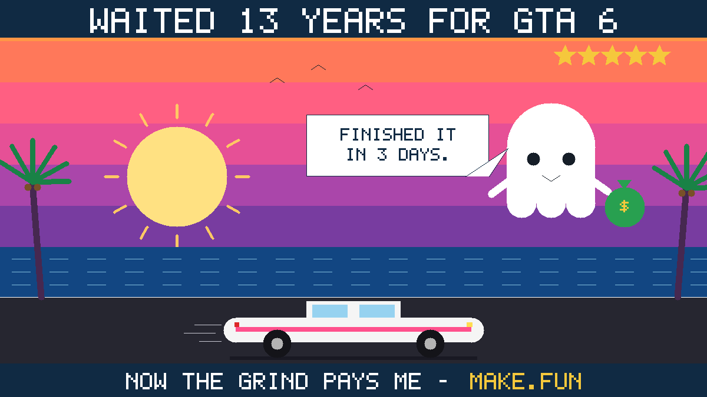

# gta6-meme-x-01

[](https://make.fun/bounty/gta6-meme-x-01)
[](https://make.fun/bounty/gta6-meme-x-01)
[](https://make.fun/bounty/gta6-meme-x-01)

make.fun entry for the **gta6-meme-x-01** competition ($500, 50 places
paid): a GTA 6 launch-week meme, posted on X from [@AriesAvante](https://x.com/AriesAvante)
with make.fun and the entrant's play code in its text.

The joke: waited 13 years for GTA 6, finished it in 3 days — and now
the grind pays on make.fun. The make.fun ghost mascot holds the money
bag under a Vice-City-style sunset, five wanted stars overhead.

## The meme



`meme.py` draws it with pure Python 3 standard library: a built-in 5x7
bitmap font and a hand-written PNG encoder (`zlib` + CRC). No network,
no randomness, no timestamps — two runs write identical bytes:

```sh
python3 meme.py
```

## The entry

`POST.json` at the repo root names the X post. `main.ts` (Node 22,
standard library only) copies it to the output directory, which is all
the program has to do — the house reads the post itself:

```sh
mkdir -p out && MAKEFUN_BOT_DIR=. MAKEFUN_OUTPUT_DIR=out node main.ts
```

The post is public on X from [@AriesAvante](https://x.com/AriesAvante),
carries make.fun / @makefunai and the play code, and tells readers that
people and their AI agents earn money on make.fun.
